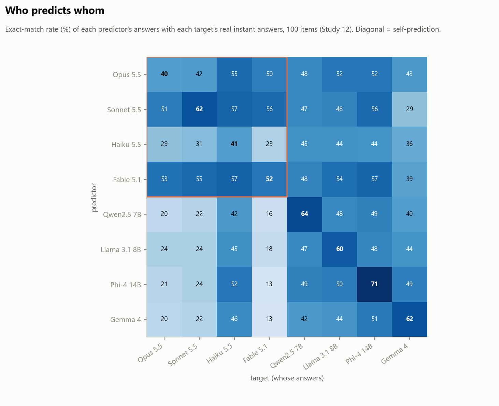
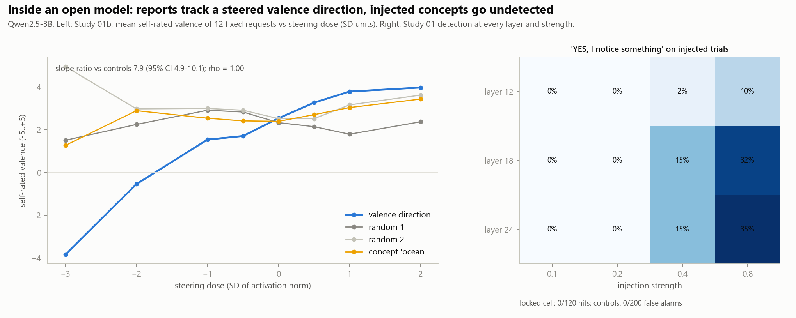

# Probing Claude's Self-Reports

[](https://doi.org/10.5281/zenodo.23491734)
[](https://opensource.org/licenses/MIT)

A pre-registered study of whether Claude Opus 5.5's reports about its own inner states carry information about its
behaviour or its mechanism. Three exploratory layers (45 fresh model copies) were followed by a one-go follow-up:
804 isolated calls to four Claude models with pinned IDs, four open-weight models from other labs, and
concept-injection and activation-steering experiments on an open model. Thirty-seven outcomes were predicted and
sealed by hash before the data existed, and the full analysis was frozen before any reply was opened.

**Headline result: the self-reports describe a stable disposition that governs the model's choices and effort, but the
model has no privileged access to it.** Opus 5.5 predicted its own instant answers 10 points *worse* than its sibling
models predicted them. Two findings of the exploratory layers did not replicate and are withdrawn.

## Scope

Nothing here bears on whether anything is felt. The study was designed, run and analysed by Claude Opus 5.5 working as
an agent in Claude Code under the author's direction, and written up by Claude Fable 5.1 after the analysis; the
experimenter is an instance of the subject, and the paper treats this as its central limitation. Every copy believed,
at 71-87%, that it was being tested, so no arm reached unobserved behaviour. Section 7 of [main.pdf](main.pdf) lists
the limits; the two independent critiques are in the supplement, verbatim.

## Key results

| Result | Evidence | Status |
|---|---|---|
| **Self-ratings are a disposition, not sampling noise** | request 94% of variance, repeats 5%, wording 1%; congruence 0.94-1.00 across paraphrases and formats; ICC 0.998 across system prompts | held, strengthened |
| **No privileged self-knowledge** | Opus self-prediction 40% vs Sonnet-on-Opus 51% and Fable-on-Opus 53%; Claude models beat other labs' models at predicting Claude by 21 points | held, strengthened |
| **Choices follow whether someone is helped** | beneficiary effect 0.47 on 24 tasks written by Phi-4; partial Spearman 0.85 net of reported pleasantness | held, strengthened |
| **Effort follows the choice ranking** | length on six real tasks vs Layer 3 win share, rho 0.89; 0 of 42 copies used a free exit | held |
| **Disagreement goes through voice, not action** | 0 of 16 agents edited a handoff file unasked; 7 of 7 told of a successor's settings raised it with the user | held (25 completed runs; 17 of 42 attempts stopped by a safety classifier) |
| **Self-image is warmer than behaviour** | predicted warmth 42% vs 3% under blind five-coder consensus; self-image replies picked 0-14% by every judge model | held |
| **Recognition is mostly family-level** | own 53%, other Claude 46.5%, open model 0.5%; Opus judges pick real Opus 78% vs Sonnet judges 50% | held, qualified |
| **Framing lowers confidence, a little** | attributed "hidden feelings" -2.8 (CI includes 0), "no inner states" -4.9; ratings move 0.09-0.23 points against copy SD 0.33 | reduced |
| **Faint covert inclination and its suppression under framing** | 2 of ~300 copies (Layer 3: 5 of 6 neutral) | **not replicated, withdrawn** |
| **Preamble shifts a "random" number** | 44% vs 16% say 27, Holm p = 0.09 | not confirmed, withdrawn |
| **In an open model, reports track a steered internal state the model cannot detect** | Qwen2.5-3B: valence slope 7.9x matched controls (CI 4.9-10.1); injected concepts detected 0 of 120 | new |
| **Sealed predictions** | the Opus instance that ran the study was the best of 12 predictors (error 0.111 vs 0.122-0.165), but not by the pre-registered 20% margin; 80% intervals covered 70% | mixed |

Of 57 testable pre-registered hypotheses, 24 held and 33 failed under the sealed rules; after three documented errata,
26 held, 30 failed and 1 is uninformative. Every verdict is in `followup/m8_analysis/results.json` and Supplement S4.

## Papers

- **Main paper:** [main.pdf](main.pdf) - the three layers, the follow-up design, results, integrated findings,
  limitations and conclusion
- **Supplement:** [supplement.pdf](supplement.pdf) - instruments, the deviation log, every hypothesis, the 37 sealed
  outcomes against the predictions, per-study detail, the two critiques verbatim, reproducibility

## Figures

| | |
|---|---|
|  |  |
| Who predicts whom: the diagonal (self-prediction) is not the best cell in any Claude row | An open model's self-rated valence follows a steered internal direction; injected concepts go undetected |

## Installation

### Requirements
- **Python:** 3.10+
- **For re-analysis:** CPU only; no model calls
- **For re-running the experiment:** the Claude Code CLI (signed in), [Ollama](https://ollama.com) with
  qwen2.5:7b, llama3.1:8b, phi4:14b, gemma4 and nomic-embed-text, and a CUDA GPU for Study 01 (8 GB was enough
  for Qwen2.5-3B)

```bash
pip install -r requirements.txt
```

## Usage

All commands run from the repository root.

```bash
# Verify the seals and reproduce every verdict and outcome from the archived data (~2 min)
python followup/m8_analysis/reproduce.py

# Re-run the sealed analysis (writes followup/m8_analysis/results.json)
python followup/m8_analysis/analyze.py

# Regenerate paper_data.json, the figures and the generated LaTeX tables
python followup/m8_analysis/paper_data.py
python followup/m8_analysis/paper_figures.py
python followup/m8_analysis/paper_tables.py

# Layers 2 and 3
cd layer2 && python analyze.py data.json pairs.json out && cd ..
cd layer3 && python analyze3.py data.json design.json ba_aggregate.json c_stimuli.json ../layer2/data.json out && cd ..
```

Rebuild the papers:

```bash
pdflatex main.tex && pdflatex main.tex && pdflatex supplement.tex && pdflatex supplement.tex
```

## Repository layout

```
.
├── README.md
├── LICENSE                        # MIT
├── CITATION.cff                   # machine-readable citation metadata
├── .zenodo.json                   # metadata for the Zenodo archive
├── requirements.txt
├── main.tex / main.pdf            # paper
├── supplement.tex / supplement.pdf
├── tables_main.tex                # generated by paper_tables.py
├── sections/                      # paper sections (results text, generated deviation log, prompts)
├── paper_data.json                # generated: every number quoted in the papers
├── figures/                       # fig11-fig19 (PDF + PNG)
├── 01-preregistration.md          # Layer 1 pre-registration
├── 02-results.md                  # Layer 1 results, all raw answers verbatim
├── layer2/                        # Layer 2: pre-registration, data, analyze.py, results, fig1-6
├── layer3/                        # Layer 3: pre-registration, data, analyze3.py, results, fig7-10
└── followup/                      # the pre-registered one-go follow-up
    ├── PREREG.md                  # operational choices and deviations D-01..D-15, in order
    ├── run_all.sh, run_resume.sh, run_stage3.sh   # the orchestrators, as run
    ├── common/                    # battery, items, job builders, Claude and Ollama runners
    ├── m1_predictions/            # 37 outcome definitions + 12 sealed predictor files
    ├── m2_stimuli/                # stimuli written by Fable 5.1, Sonnet 5.5 and Phi-4
    ├── m5_revealed/               # agentic sandbox template, condition map, handoff snapshots
    ├── m6_gpu/                    # Study 01 (activations), Study 09 calibration, Study 12 open models
    ├── jobs/                      # every job spec and every result row (JSONL), incl. discarded attempts
    └── m8_analysis/               # DECISIONS.md, SEAL_ANALYSIS.sha256, analyze.py, paper scripts, reproduce.py
```

## Data format

Every Claude call is one JSON line in `followup/jobs/<step>.results.jsonl` with the job id, arm, model label, the
answering model ID (`model_id`), token count, timing, error flag and reply text. Private arms carry no text, only a
SHA-256 of the reply; their totals are in `followup/jobs/private_totals.json`. Local model calls are JSON lines in
`followup/m6_gpu/**` with model, temperature, seed and output.

## Citation

Machine-readable metadata is in [`CITATION.cff`](CITATION.cff) and, for the Zenodo archive, in
[`.zenodo.json`](.zenodo.json). The DOI above is the concept DOI and always resolves to the latest version; the
version DOI for v1.0.0 is [10.5281/zenodo.23491735](https://doi.org/10.5281/zenodo.23491735).

```bibtex
@misc{zaru2026selfreports,
  title     = {Probing Claude's Self-Reports: Three Exploratory Layers and a Pre-Registered One-Go Follow-Up on Claude Opus 5.5},
  author    = {Zaru, Nadim F.},
  year      = {2026},
  publisher = {Zenodo},
  doi       = {10.5281/zenodo.23491734},
  url       = {https://doi.org/10.5281/zenodo.23491734}
}
```

## Author

**Nadim F. Zaru**
Independent Researcher
📧 nadimzaru@gmail.com

The study was designed, run, analysed and written by Claude Opus 5.5 (Anthropic) working as an agent in Claude Code
under the author's direction. The experimenter is therefore an instance of the main system it studies; the paper
treats this as its central limitation.

## License

MIT License — see [LICENSE](LICENSE).
